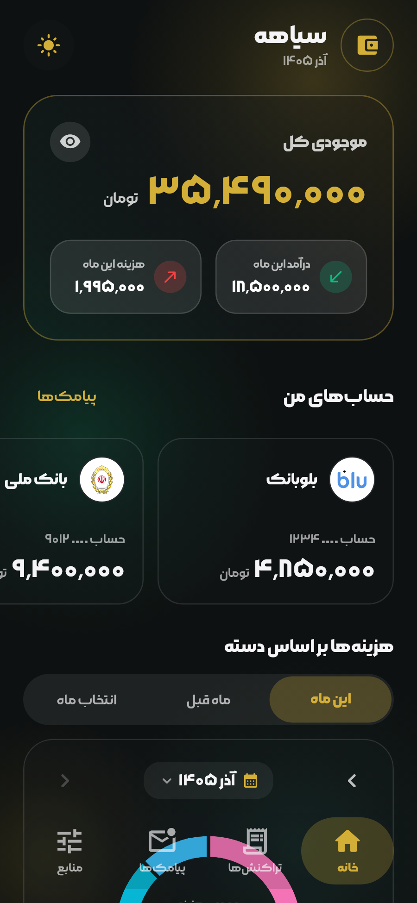
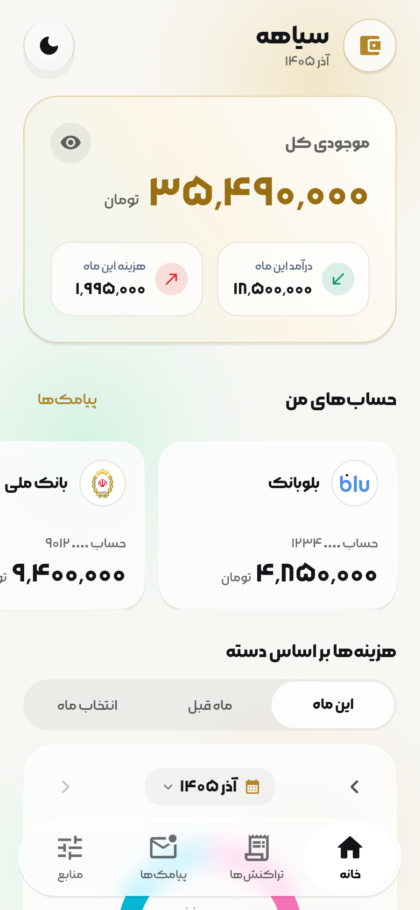
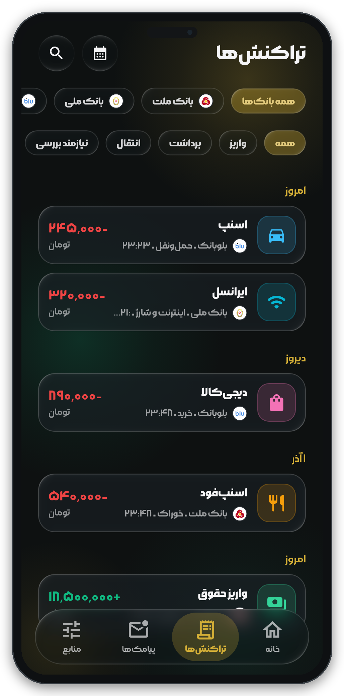
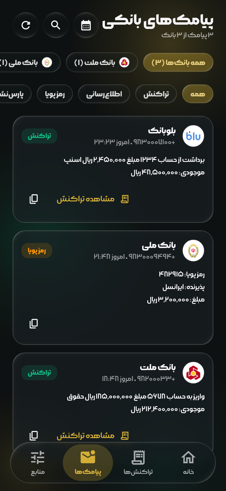

<div align="center">
  
  <h1>Siaheh | سیاهه</h1>
  <p>
    <strong>100% offline smart personal finance &amp; bank account tracker powered by Iranian bank SMS parsing</strong>
  </p>
  <p>
    <em>Modern Liquid Glass UI • Full Jalali (Shamsi) calendar support • Zero servers, zero tracking</em>
  </p>
  <p>
    <a href="README.md">فارسی</a> | <strong>English</strong>
  </p>
</div>

---

## Screenshots

<div align="center">
  <table>
    <tr>
      <td align="center"><strong>Home (Dark Mode)</strong></td>
      <td align="center"><strong>Home (Light Mode)</strong></td>
      <td align="center"><strong>Transactions</strong></td>
      <td align="center"><strong>Bank Messages</strong></td>
    </tr>
    <tr>
      <td></td>
      <td></td>
      <td></td>
      <td></td>
    </tr>
  </table>
</div>

---

## Key Features

- **100% Offline & Private:** All SMS parsing, balance tracking, categorization, and storage run locally on-device with no internet permission or external servers.
- **Automatic Iranian Bank & Account Detection:** Recognizes major Iranian banks and neo-banks (Melli, Mellat, BluBank, Saman, Pasargad, Tejarat, Saderat, Refah, Shahr, Sepah, Keshavarzi, Maskan, etc.) while accurately filtering out promotional messages and telecom operators.
- **Smart Expense Categorization + OTP Correlation:**
  - Automatically identifies Iranian merchants and services (Snapp, Tapsi, Digikala, Irancell, MCI, cafés, etc.) from transaction SMS text or correlated dynamic password (`رمز پویا` / OTP) SMS messages within a matching time window.
  - Supports user-created custom categories with custom icons/colors and learned merchant rules for similar future transactions.
- **Automatic Internal Transfer Detection:** Pairs debits and credits across the user's own accounts (including Shaparak transfer fees) so internal transfers do not inflate monthly income or expense totals.
- **Interactive Donut Chart & Full Jalali Filtering:**
  - Inspect spending breakdowns by category for any Jalali (Shamsi) month or year.
  - Filter transactions and bank messages by Today, Last 7 Days, Month, or Year.
- **60 FPS Liquid Glass UI (Dark & Light Themes):** Smooth glassmorphic interface supporting instant switching between Dark and Light modes.

---

## Download & Install

Download the APK matching your device ABI from [**Releases**](https://github.com/Lilfibonacci/siaheh/releases):

| File | Target Devices | Approx. Size |
| --- | --- | --- |
| `app-arm64-v8a-release.apk` | Most modern 64-bit Android phones | ~21 MB |
| `app-armeabi-v7a-release.apk` | Older 32-bit Android phones | ~19 MB |
| `app-x86_64-release.apk` | Emulators and x86_64 devices | ~23 MB |

---

## Architecture & Tech Stack

The project follows **Clean Architecture** with strict layer boundaries:

```text
lib/
├── core/            # Dependency injection (di), failures (error), routing (router), themes, and shared utilities
├── domain/          # Pure Dart with zero Flutter or Data dependencies:
│   ├── entities/    # Immutable domain entities & Jalali date filter
│   ├── repositories/# Abstract repository contracts
│   └── usecases/    # Base UseCase contracts (usecase.dart) + Finance & Theme use cases
├── data/            # Data layer:
│   ├── datasources/ # Local (Hive) & platform (Android SMS) datasource interfaces and implementations
│   ├── dtos/        # Persistence & platform Data Transfer Objects
│   ├── mappers/     # DTO <-> Entity mappers
│   ├── parsers/     # SMS normalization, bank detection, generic/specific parsers, OTP correlation
│   └── repositories/# Repository implementations
└── presentation/    # Presentation layer:
    ├── bloc/        # Standard BLoC state management (FinanceBloc & ThemeBloc), UI models & mappers
    ├── screens/     # App screens & dashboard tabs
    └── widgets/     # Reusable Liquid Glass widgets & bottom sheets
```

- **Flutter & Dart** (`sdk: ^3.13.5`)
- **State Management:** `flutter_bloc` (standard `Bloc<Event, State>`) + `equatable`
- **Local Database:** `hive_ce` / `hive_ce_flutter`
- **UI & Charts:** `liquid_glass_widgets`, `fl_chart`, `lottie`
- **Calendar, Routing & DI:** `shamsi_date`, `go_router`, `get_it`
- **High-Performance Android SMS Sync:** Background-threaded Kotlin `MethodChannel` + batch parsing inside Dart `Isolate`s

---

## Build & Run

```bash
# Install dependencies
flutter pub get

# Run static analysis and tests
flutter analyze && flutter test

# Build compact split-per-ABI release APKs
flutter build apk --release --split-per-abi
```

---

## Contributing

Contributions are welcome—especially new Iranian bank SMS patterns, merchant keywords, and UI improvements:

1. **Fork** the repository and create a new branch (`git checkout -b feat/your-feature`).
2. Add unit tests under `test/` whenever introducing or modifying a parser or bank pattern.
3. Ensure `flutter analyze` and `flutter test` pass cleanly before opening a PR.
4. Submit a **Pull Request** with a clear summary of your changes.

---

## Credits

- Iranian bank and brand SVG logos are sourced from [**persianlabs/icons**](https://github.com/persianlabs/icons) (MIT License — see [LICENSE-persianlabs-icons.txt](assets/icons/banks/LICENSE-persianlabs-icons.txt)).
- Liquid Glass UI components are built with [`liquid_glass_widgets`](https://pub.dev/packages/liquid_glass_widgets).

---

## License

This project is licensed under the **MIT License**. See [LICENSE](LICENSE) for details.
